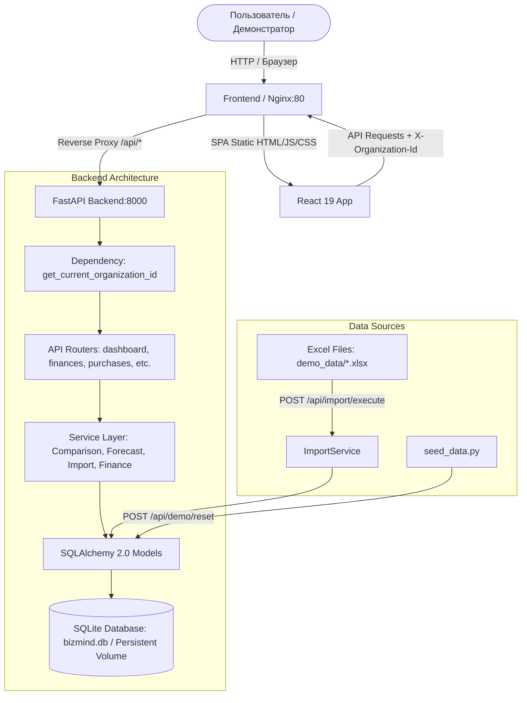

# BizMind: Руководство пользователя, демонстратора и разработчика

> **Версия документа:** 1.0.0  
> **Статус системы:** Рабочий MVP с поддержкой двух независимых демонстрационных пространств  
> **Стек:** Frontend (React 19, TypeScript, Vite, Tailwind CSS, Recharts, Lucide), Backend (FastAPI, Python 3.12, SQLAlchemy, SQLite, openpyxl, pandas), Контейнеризация (Docker, Docker Compose, Nginx).

---

## 1. Что представляет собой продукт BizMind

### 1.1. Назначение
**BizMind** — это специализированная аналитическая B2B SaaS-платформа для владельцев и управляющих заведений сферы HoReCa (кофеен, кафе, пекарен, фастфуд-точек) и малого ритейла. Платформа решает ключевую операционную проблему малого бизнеса: **незаметную потерю маржинальности из-за инфляции цен поставщиков, дефицита сырья и нерегулярного контроля закупщика**.

BizMind непрерывно сопоставляет фактические закупочные цены с прайс-листами альтернативных поставщиков, выявляет скрытые подорожания, рассчитывает экономическую разницу на сопоставимый объем закупки и формирует статистический прогноз истощения складских остатков.

### 1.2. Целевая аудитория
- **Владельцы и соучредители кофеен и кафе:** которым необходимо понимать реальную динамику расходов, не погружаясь в громоздкие бухгалтерские ведомости.
- **Управляющие заведениями:** ответственные за операционный бюджет, своевременный заказ расходных материалов и исключение стоп-листов.
- **Менеджеры по закупкам / шеф-бариста:** которым требуется инструмент быстрого аудита коммерческих предложений и выбора надежных поставщиков с прозрачными условиями доставки.

### 1.3. Основные возможности платформы
1. **Сводный дашборд:** мгновенная визуализация расходов, выручки, динамики по категориям, структуры затрат, критических алертов и экспресс-калькулятор закупки; для новых организаций — адаптивный онбординг-маршрут (Roadmap).
2. **Аудит цен и выявление скачков:** автоматическое обнаружение резкого роста стоимости единицы товара по сравнению с исторической базой.
3. **Общий каталог поставщиков и сравнение предложений:** встроенная база BizMind и пользовательские импортированные контрагенты с прозрачными метками происхождения (`Из базы BizMind` vs `Импортирован` vs `Вручную`), нормализацией к базовым единицам и учетом доставки.
4. **Конструктор отчётов (Report Builder):** визуальный шаблонизатор управленческих отчетов с 4 системными пресетами, гибкими фильтрами, группировкой, интерактивным предпросмотром (KPI + графики) и профессиональным экспортом в Excel (`.xlsx`) и CSV.
5. **Два бизнес-сценария:** 
   - *Cafe Aroma* — чистое первоначальное внедрение (0 фиктивных операций, отсутствие ложных прогнозов, пошаговый импорт файлов);
   - *Daily Cup* — зрелая 6-месячная история с подтвержденной реализованной экономией 153 200 ₸.
6. **Статистический прогноз запасов:** расчет среднего суточного расхода сырья на основе истории закупок, прогноз остатков на 7, 14 и 30 дней, рекомендации по объему следующего заказа.
7. **Журнал финансовых операций:** учет доходов и расходов по статьям затрат (аренда, ФОТ, коммуналка, кофе, упаковка), аналитика сальдо и фильтрация.
8. **Центр уведомлений:** приоритизированные сигналы четырех уровней важности (скачки цен, альтернативные офферы, неснижаемые остатки, рост категорий).
9. **Модуль импорта Excel/CSV:** загрузка исторических таблиц из внешних систем или файлов Excel с предварительным просмотром, валидацией заголовков и детализированным протоколом импорта.
10. **Мультитенантность демонстрационных пространств:** мгновенное переключение между изолированными кейсами без смешивания данных.
11. **Адаптивный мобильный интерфейс (Mobile-First Ergonomics):** полнофункциональное off-canvas мобильное меню, горизонтальный touch-скролл таблиц без усечения валютных сумм, адаптивные графики и модальные окна, защищённые от перекрытия экранной клавиатурой смартфона.

### 1.4. Какие управленческие решения помогает принимать BizMind
- **Своевременная смена поставщика:** аргументированный переход к поставщику с более выгодным тарифом или обоснованный торг с текущим контрагентом на основе рыночных альтернатив.
- **Предотвращение стоп-листов:** упреждающий заказ ключевых позиций (молоко, крафтовые стаканы, зерно) за 2–3 дня до критического истощения.
- **Контроль структуры себестоимости:** локализация статей затрат, которые растут быстрее выручки, и защита плановой маржинальности меню.

### 1.5. Отличие от бухгалтерских систем (1С, МойСклад, Palomars)
- **Бухгалтерские системы** ориентированы на фиксацию первичных документов, налоговую отчетность, списание по технологическим картам и инвентаризацию. Они фиксируют прошлое постфактум.
- **BizMind** — это **надстройка оперативного принятия решений (Decision Intelligence)**. Платформа отвечает на вопросы: *«Где кофейня переплачивает прямо сейчас?»*, *«Сколько можно сэкономить при смене поставщика?»*, *«Когда наступит дефицит стаканов при текущем темпе продаж?»*.

### 1.6. Реальный функционал vs Моковые интеграции
| Компонент / Модуль | Статус реализации | Описание работы в MVP |
|---|---|---|
| Хранение данных | **100% реальный** | Полноценная реляционная БД SQLite через SQLAlchemy 2.0 с внешними ключами и каскадным удалением. |
| Аналитический движок | **100% реальный** | Все проценты изменения, разницы в ценах, среднее потребление и прогноз рассчитываются программно на Python. |
| Импорт Excel (.xlsx) | **100% реальный** | Реальный парсинг бинарных файлов библиотеками `openpyxl` и `pandas`, детекция колонок, создание записей в БД. |
| Мультитенантность | **100% реальный** | Строгая изоляция записей по `organization_id` через заголовок `X-Organization-Id`. |
| Каталог предложений поставщиков | **Моковая модель** | Предложения поставщиков загружаются из подготовленного прайс-листа; реальные API поставщиков эмулируются. |
| Платежный шлюз | **Отсутствует (Out of scope)** | BizMind не списывает деньги с расчетных счетов и не проводит банковские транзакции. |
| Синтетические данные | **Специально подготовленные** | История операций за 4–6 месяцев отражает типичную экономику кофейни в Казахстане в тенге (₸). |

---

## 2. Архитектура проекта

### 2.1. Структура репозитория

```text
BizMind/
├── backend/                         # FastAPI приложение (Python 3.12)
│   ├── src/
│   │   └── backend/
│   │       ├── api/                 # Контроллеры и HTTP-маршруты
│   │       │   ├── auth.py          # Авторизация, демо-логин, смена организаций
│   │       │   ├── dashboard.py     # Сводные метрики и графики
│   │       │   ├── demo.py          # Управление демо-файлами и сбросом
│   │       │   ├── deps.py          # Зависимости FastAPI (get_current_organization_id)
│   │       │   ├── finances.py      # Финансовые транзакции и категории
│   │       │   ├── forecast.py      # Прогноз остатков и потребности
│   │       │   ├── imports.py       # Загрузка и валидация Excel
│   │       │   ├── notifications.py # Уведомления и статусы прочтения
│   │       │   ├── purchases.py     # Партии закупок и история цен товаров
│   │       │   └── suppliers.py     # Поставщики и сервис сравнения
│   │       ├── demo/                # Генерация демонстрационных данных
│   │       │   ├── generate_demo_files.py # Генерация 8 Excel-файлов
│   │       │   └── seed_data.py     # Детерминированное заполнение базы
│   │       ├── models/
│   │       │   └── models.py        # SQLAlchemy сущности БД
│   │       ├── schemas/
│   │       │   └── schemas.py       # Pydantic v2 схемы запросов и ответов
│   │       ├── services/            # Сервисный слой с бизнес-логикой
│   │       │   ├── comparison_service.py # Расчет разницы цен и условий
│   │       │   ├── dashboard_service.py  # Сборка сводных метрик дашборда
│   │       │   ├── finance_service.py    # Агрегация финансов и фильтрация
│   │       │   ├── forecast_service.py   # Статистический прогноз расхода
│   │       │   ├── import_service.py     # Парсинг и сохранение Excel
│   │       │   ├── notification_service.py # Управление уведомлениями
│   │       │   └── purchase_service.py   # Вычисление динамики закупок
│   │       ├── database.py          # Инициализация SQLite / SessionLocal
│   │       └── main.py              # Точка входа FastAPI, CORS, lifespan
│   ├── tests/                       # Автоматические тесты
│   │   └── test_isolation_and_demo.py # 7 тестов изоляции, импорта и расчетов
│   ├── Dockerfile                   # Python 3.12 slim контейнер
│   └── pyproject.toml               # Зависимости backend
├── frontend/                        # Клиентское приложение (React 19 + Vite)
│   ├── src/
│   │   ├── components/              # Переиспользуемые UI-компоненты
│   │   │   ├── Navbar.tsx           # Верхняя панель со статусом и периодом
│   │   │   ├── Sidebar.tsx          # Меню навигации и переключатель кофеен
│   │   │   ├── PriceAlertBanner.tsx # Баннер обнаруженного скачка цен
│   │   │   ├── AddTransactionModal.tsx # Модальное окно создания операции
│   │   │   └── ProductHistoryModal.tsx # График истории закупочных цен
│   │   ├── pages/                   # Страницы приложения
│   │   │   ├── LoginPage.tsx        # Экран входа с выбором двух сценариев
│   │   │   ├── DashboardPage.tsx    # Главный экран аналитики
│   │   │   ├── FinancesPage.tsx     # Журнал доходов и расходов
│   │   │   ├── PurchasesPage.tsx    # История закупок и аудит партий
│   │   │   ├── ComparisonPage.tsx   # Сравнение предложений поставщиков
│   │   │   ├── ForecastPage.tsx     # Прогноз складских остатков
│   │   │   ├── NotificationsPage.tsx# Центр уведомлений
│   │   │   └── ImportSettingsPage.tsx# Импорт Excel и сброс демо-базы
│   │   ├── services/
│   │   │   └── api.ts               # Axios клиент с интерцептором X-Organization-Id
│   │   ├── types/
│   │   │   └── index.ts             # TypeScript интерфейсы
│   │   ├── utils/
│   │   │   └── formatters.ts        # Форматирование ₸, дат, процентов
│   │   ├── App.tsx                  # Главный компонент, роутинг и контекст
│   │   └── main.tsx                 # Точка монтирования React
│   ├── nginx.conf                   # Конфиг Nginx для SPA и reverse-proxy /api/
│   ├── Dockerfile                   # Multi-stage сборка Nginx + dist
│   └── package.json                 # Зависимости frontend
├── demo_data/                       # Образцы файлов Excel для онбординга
├── docker-compose.yml               # Оркестрация backend + frontend + volume
├── .dockerignore                    # Исключения сборки контейнеров
├── .env.example                     # Шаблон переменных окружения
├── README.md                        # Главное описание проекта
├── BIZMIND_GUIDE.md                 # Настоящее подробное руководство
├── docs/                            # 📚 Детальная документация подсистем
│   ├── API.md                       # Полная спецификация REST API
│   ├── USER_SCENARIOS.md            # 22 сквозных пошаговых сценария
│   ├── DEMO_DATA.md                 # Описание демо-сценариев и каталога поставщиков
│   ├── REPORT_BUILDER.md            # Спецификация конструктора отчетов
│   ├── TESTING.md                   # Отчет о тестировании (36 тестов)
│   ├── DEPLOYMENT.md                # Руководство по развертыванию на Linux VPS
│   └── AUDIT.md                     # Архитектурный аудит и протокол доработок
└── backend/
    └── DATABASE.md                  # 🗄️ Полная документация архитектуры БД (15 моделей)
```

### 2.2. Поток данных и взаимодействие компонентов



### 2.3. Где находится бизнес-логика
- **Расчет скачков цен и сравнение поставщиков:** `backend/src/backend/services/comparison_service.py`. Вычисляет разницу:
  $$\text{UnitDifference} = \text{CurrentUnitPrice} - \text{OfferedPrice}$$
  $$\text{TotalDifference} = \text{UnitDifference} \times \text{SelectedQuantity}$$
  $$\text{DeliveryImpact} = \text{AlternativeDeliveryCost} - \text{CurrentDeliveryCost}$$
  $$\text{NetDifference} = \text{TotalDifference} - \text{DeliveryImpact}$$
- **Статистический прогноз расхода:** `backend/src/backend/services/forecast_service.py`. Анализирует закупки за последние 90 дней, вычисляет среднесуточное потребление $\text{AvgDaily} = \frac{\text{TotalQuantity}}{\text{DaysSpan}}$, рассчитывает оставшиеся дни до нуля $\text{DaysLeft} = \frac{\text{CurrentStock}}{\text{AvgDaily}}$ и рекомендует объем дозаказа.
- **Сборка показателей дашборда:** `backend/src/backend/services/dashboard_service.py`. Агрегирует доходы и расходы за выбранный период (30 дней, 90 дней, месяц, все время), рассчитывает процент изменения к предшествующему периоду аналогичной длины и определяет наиболее актуальный товар для экспресс-калькулятора.
- **Парсинг и импорт Excel:** `backend/src/backend/services/import_service.py`. Обеспечивает нечеткое сопоставление русских колонок («Дата», «Сумма», «Поставщик», «Количество»), валидацию строк и дедупликацию записей.

---

## 3. User Personas

### 3.1. Persona 1: Алексей Смирнов (Владелец Cafe Aroma)
- **Контекст:** Открыл кофейню 6 месяцев назад в Алматы на ул. Абая 45. До последнего времени все расходы записывал в Excel-файлы или блокнот. Закупки делегировал старшему бариста.
- **Проблема:** Заметил, что к концу месяца свободного остатка денег на счету стало меньше, хотя поток гостей не снижался. Подозревает, что выросли закупочные цены, но не имеет времени перебирать бумажные накладные.
- **Цели в BizMind:**
  1. Быстро загрузить существующие таблицы Excel и увидеть сводную финансовую картину.
  2. Найти позиции, по которым поставщики незаметно подняли цены.
  3. Проверить, какие есть альтернативные поставщики кофе на рынке Алматы.
  4. Убедиться, что на складе есть запас молока перед выходными.
- **Ожидаемый результат:** Четкое понимание, что поставщик Coffee Roasters Hub поднял цену на кофе на 15%, и обоснованное решение переключиться на Aroma Direct с экономией 23 000 ₸ на каждые 20 кг.

### 3.2. Persona 2: Данияр Касымов (Операционный директор Daily Cup)
- **Контекст:** Руководит сетью кофеен формата To-Go (флагманская точка на ул. Достык 89). Система BizMind внедрена и непрерывно используется более 5 месяцев.
- **Проблема:** Высокий оборот стаканов и одноразовой посуды (более 3 000 стаканов в месяц). Любое повышение цены упаковки даже на 15–20% снижает маржинальность на сотни тысяч тенге в квартал. Кроме того, дефицит держателей для стаканов останавливает продажи сетов «кофе с собой».
- **Цели в BizMind:**
  1. Провести оперативный утренний аудит уведомлений.
  2. Обнаружить скачок цены на крафтовые стаканы 250мл от PackGroup Almaty (+18.3%).
  3. Сравнить предложения EcoTorg Kazakhstan и оценить экономию с учетом бесплатной доставки.
  4. Проконтролировать прогноз остатков и предотвратить дефицит держателей стаканов (осталось 6 упак).
- **Ожидаемый результат:** Переход на альтернативного поставщика упаковки с выгодой 190 ₸/упак и оформление заказа держателей до наступления стоп-листа.

---

## 4. User Stories

| ID | User Story | Критерии приемки (Given / When / Then) |
|---|---|---|
| **US-01** | **Вход в систему**<br>Как демонстратор, я хочу войти в демо-аккаунт в один клик без ввода пароля, чтобы быстро начать показ. | **Given:** открыт экран `/login`.<br>**When:** пользователь нажимает «Войти в кейс Cafe Aroma» или «Войти в кейс Daily Cup».<br>**Then:** система авторизует пользователя и перенаправляет на Сводный дашборд соответствующей организации. |
| **US-02** | **Переключение организации**<br>Как пользователь, я хочу мгновенно переключаться между Cafe Aroma и Daily Cup, чтобы сравнивать сценарии. | **Given:** пользователь находится на любой странице приложения.<br>**When:** пользователь открывает селектор в сайдбаре и выбирает другую организацию.<br>**Then:** все экраны мгновенно очищаются и перезагружают изолированные данные выбранной кофейни. |
| **US-03** | **Импорт Excel-таблицы**<br>Как управляющий Cafe Aroma, я хочу загрузить файл с историей операций, чтобы увидеть проверку данных до сохранения. | **Given:** открыта вкладка «Импорт и данные».<br>**When:** выбран файл `legacy_finances.xlsx` и нажат предпросмотр.<br>**Then:** отображается зеленая плашка «Файл валиден», список найденных колонок и превью первых 3 строк. |
| **US-04** | **Просмотр сводного дашборда**<br>Как владелец, я хочу видеть ключевые метрики за 30 дней, чтобы оценить состояние бизнеса. | **Given:** активна вкладка «Дашборд».<br>**When:** выбран период «30 дней».<br>**Then:** отображаются 4 карточки (расходы, динамика к пред. периоду, потенциал оптимизации, выручка) и графики. |
| **US-05** | **Обнаружение скачка цен**<br>Как управляющий, я хочу видеть яркий баннер о росте цен на сырье, чтобы не пропустить переплату. | **Given:** в системе зафиксирован рост цены товара более чем на 5%.<br>**When:** открывается Дашборд.<br>**Then:** сверху отображается красный баннер с указанием процента скачка (+15% для Cafe Aroma, +18.3% для Daily Cup) и кнопкой перехода к сравнению. |
| **US-06** | **Сравнение поставщиков**<br>Как закупщик, я хочу видеть ранжированный список предложений, чтобы выбрать наиболее выгодное. | **Given:** открыта вкладка «Сравнение цен».<br>**When:** выбран товар и указан объем закупки.<br>**Then:** система подсвечивает карточку «Лучшее предложение» с расчетом чистой выгоды с учетом доставки. |
| **US-07** | **Интерактивный калькулятор**<br>Как управляющий, я хочу менять объем закупки на ползунке, чтобы видеть точную сумму потенциальной экономии. | **Given:** открыт экспресс-калькулятор на Дашборде или в Сравнении цен.<br>**When:** пользователь перемещает ползунок объема закупки.<br>**Then:** сумма потенциальной разницы мгновенно пересчитывается без перезагрузки страницы. |
| **US-08** | **Контроль остатков и прогноз**<br>Как бариста/управляющий, я хочу знать, на сколько дней хватит запаса, чтобы вовремя сделать заказ. | **Given:** открыта страница «Прогноз остатков».<br>**When:** система анализирует текущие остатки и историю расхода.<br>**Then:** позиции сортируются по срочности; критические товары (молоко для Cafe Aroma, держатели для Daily Cup) выделены красным с пометкой «менее 3 дней». |
| **US-09** | **Добавление операции вручную**<br>Как пользователь, я хочу быстро добавить внеплановый расход, чтобы учесть непредвиденные траты. | **Given:** нажата кнопка «+ Операция» в верхней панели.<br>**When:** заполнены сумма, категория и описание, нажато «Сохранить».<br>**Then:** операция немедленно сохраняется в БД и обновляет показатели расходов на Дашборде. |
| **US-10** | **Сброс демонстрационной базы**<br>Как демонстратор, я хочу вернуть обе организации к исходному состоянию, чтобы провести демо заново. | **Given:** открыта вкладка «Импорт и данные».<br>**When:** нажата кнопка «Восстановить демо-базу» и подтверждено действие.<br>**Then:** база детерминированно пересоздается, восстанавливая оба сценария. |

---

## 5. Use Cases (Каталог вариантов использования)

### UC-01: Вход в демонстрационное пространство
- **Актор:** Демонстратор / Пользователь.
- **Цель:** Начать работу в выбранном демонстрационном кейсе.
- **Предусловия:** Сервер backend и frontend запущены.
- **Основной сценарий:**
  1. Открыть веб-интерфейс по адресу приложения (`http://localhost:5173` или `http://localhost`).
  2. На открывшемся экране отображаются две карточки: «Cafe Aroma (Первоначальное внедрение)» и «Daily Cup (Регулярное использование)».
  3. Нажать кнопку выбора нужной кофейни.
  4. Браузер сохраняет идентификатор организации и переходит на Сводный дашборд.
- **Страницы:** `LoginPage.tsx` → `DashboardPage.tsx`.
- **API:** `POST /api/auth/demo-login?org_id={1|2}`.

### UC-02: Переключение между Cafe Aroma и Daily Cup
- **Актор:** Пользователь.
- **Цель:** Сменить активную кофейню без перезагрузки страницы.
- **Предусловия:** Пользователь авторизован в системе.
- **Основной сценарий:**
  1. В левом сайдбаре нажать на блок текущей организации со стрелкой вниз.
  2. В выпадающем меню выбрать целевую организацию.
  3. Клиент отправляет запрос переключения, обновляет заголовок `X-Organization-Id` и сбрасывает кэш компонентов.
  4. Интерфейс отображает изолированные данные новой организации (статус сценария, графики, историю).
- **Страницы:** Все страницы через компонент `Sidebar.tsx`.
- **API:** `POST /api/auth/switch-org`.

### UC-03: Импорт исторических финансовых операций из Excel
- **Актор:** Управляющий Cafe Aroma.
- **Цель:** Загрузить данные из внешнего файла Excel и пополнить журнал операций.
- **Предусловия:** Скачан файл `demo_data/legacy_finances.xlsx`.
- **Основной сценарий:**
  1. Перейти в раздел «Импорт и данные».
  2. В блоке типа импорта выбрать «Финансовые операции».
  3. Нажать «Выбрать файл» и указать `legacy_finances.xlsx`.
  4. Система автоматически выполняет предпросмотр: показывает статус «Файл валиден» и первые строки.
  5. Нажать зеленую кнопку «Импортировать в базу данных».
  6. Система выводит отчет: «Успешно импортировано: 53 строки, пропущено: 0».
- **Страницы:** `ImportSettingsPage.tsx`.
- **API:** `POST /api/import/preview`, `POST /api/import/execute`.

### UC-04: Импорт истории закупок
- **Актор:** Управляющий.
- **Цель:** Загрузить историю партий закупок сырья.
- **Основной сценарий:**
  1. В разделе «Импорт и данные» выбрать тип «История закупок».
  2. Загрузить файл `legacy_purchases.xlsx` или `dailycup_purchases.xlsx`.
  3. Подтвердить импорт и перейти в раздел «Закупки» для проверки появившихся записей.
- **API:** `POST /api/import/execute`, `GET /api/purchases`.

### UC-05: Просмотр Dashboard и финансовых показателей
- **Актор:** Владелец бизнеса.
- **Цель:** Оценить текущий расход, динамику выручки и распределение по категориям.
- **Основной сценарий:**
  1. Открыть страницу «Дашборд».
  2. Переключать период (30 дней, 90 дней, Октябрь 2026, Все время) в шапке.
  3. Проанализировать диаграмму категорий (Аренда, ФОТ, Кофе, Упаковка) и динамику на графике Recharts.
- **Страницы:** `DashboardPage.tsx`.
- **API:** `GET /api/dashboard?period={period}`.

### UC-06: Поиск и фильтрация финансовых операций
- **Актор:** Бухгалтер / Управляющий.
- **Цель:** Найти конкретную транзакцию (например, закупку молока).
- **Основной сценарий:**
  1. Перейти в раздел «Финансы».
  2. В поле поиска ввести «молоко» или выбрать фильтр категории «Закупка молока и продуктов».
  3. Таблица мгновенно отфильтровывает соответствующие строки с подсчетом локальной суммы.
- **Страницы:** `FinancesPage.tsx`.
- **API:** `GET /api/finances?category={...}&search={...}`.

### UC-07: Просмотр истории закупочной цены товара
- **Актор:** Шеф-бариста / Закупщик.
- **Цель:** Изучить, как менялась цена кофе или стаканов по партиям.
- **Основной сценарий:**
  1. Открыть раздел «Закупки».
  2. В строке товара нажать иконку графика «История цен».
  3. Открывается модальное окно с графиком динамики стоимости единицы по датам закупок.
- **Страницы:** `PurchasesPage.tsx` → `ProductHistoryModal.tsx`.
- **API:** `GET /api/purchases/products/{product_id}/history`.

### UC-08: Обнаружение скачка цены и переход к сравнению поставщиков
- **Актор:** Управляющий.
- **Цель:** Локализовать завышенную цену и найти альтернативу.
- **Основной сценарий:**
  1. На Дашборде кликнуть кнопку «Сравнить предложения» на красном баннере алертов.
  2. Приложение открывает страницу «Сравнение цен» с предвыбранным товаром (Кофе или Стаканы Kraft).
  3. Пользователь видит карточку текущего поставщика и альтернативных поставщиков.
- **Страницы:** `PriceAlertBanner.tsx` → `ComparisonPage.tsx`.
- **API:** `GET /api/suppliers/comparison?product_id={id}&quantity={qty}`.

### UC-09: Расчет потенциальной разницы для выбранного объема закупки
- **Актор:** Закупщик.
- **Цель:** Оценить выгоду при заказе оптовой партии.
- **Основной сценарий:**
  1. На странице «Сравнение цен» ввести или выбрать объем (например, 20 кг кофе или 60 упаковок стаканов).
  2. Система пересчитывает потенциальную разницу с вычетом разницы в стоимости доставки.
- **Страницы:** `ComparisonPage.tsx`.
- **API:** `GET /api/suppliers/comparison`.

### UC-10: Проверка складских остатков и просмотр прогноза
- **Актор:** Бариста / Закупщик.
- **Цель:** Проверить риски дефицита перед выходными.
- **Основной сценарий:**
  1. Открыть раздел «Прогноз остатков».
  2. Оценить карточки сводки: всего товаров, критических позиций, позиций с низким запасом.
  3. Изучить строку с критическим остатком (Молоко 12л или Держатели 6 упак) и увидеть рекомендацию к дозаказу.
- **Страницы:** `ForecastPage.tsx`.
- **API:** `GET /api/forecast`.

### UC-11: Работа с уведомлениями
- **Актор:** Пользователь.
- **Цель:** Изучить сигналы системы и отметить их как прочитанные.
- **Основной сценарий:**
  1. Нажать на колокольчик в шапке или перейти в «Уведомления».
  2. Просмотреть список алертов с фильтрацией «Все» / «Только непрочитанные».
  3. Нажать галочку «Прочитано» или кнопку «Отметить все как прочитанные».
  4. Счетчик на колокольчике обнуляется.
- **Страницы:** `NotificationsPage.tsx`.
- **API:** `GET /api/notifications`, `POST /api/notifications/{id}/read`, `POST /api/notifications/read-all`.

### UC-12: Добавление финансовой операции вручную
- **Актор:** Управляющий.
- **Цель:** Зафиксировать внеплановый расход.
- **Основной сценарий:**
  1. В шапке нажать кнопку «+ Операция».
  2. В модальном окне заполнить: дата (2026-10-14), описание («Ремонт кофемолки Fiorenzato»), категория («Обслуживание оборудования»), сумма (35 000 ₸), тип («Расход»).
  3. Нажать «Сохранить операцию».
  4. Операция появляется в таблице финансов и обновляет общий итог затрат на Дашборде.
- **Страницы:** `AddTransactionModal.tsx`.
- **API:** `POST /api/finances`.

### UC-13: Сброс и восстановление демонстрационных данных
- **Актор:** Демонстратор.
- **Цель:** Восстановить базу к исходному чистому состоянию.
- **Основной сценарий:**
  1. Нажать кнопку «Сброс демо» в шапке или в разделе «Импорт».
  2. В модальном окне подтвердить действие.
  3. База пересоздается; обе организации наполняются эталонными данными.
- **API:** `POST /api/demo/reset`.

---

## 6. End-to-End демонстрационные сценарии

### Сценарий A: Первое внедрение Cafe Aroma (Миграция из Excel)
- **Хронометраж:** 4–5 минут.
- **Цель показа:** Продемонстрировать простоту перехода с Excel, моментальное обнаружение скрытого роста цен на сырье и математически обоснованный подбор альтернатив.

| Шаг | Что делает демонстратор в UI | Что говорить вслух (Реплика демонстратора) |
|---|---|---|
| **1. Вход** | Открыть приложение, на экране выбора нажать **«Войти в кейс Cafe Aroma (Внедрение)»**. | *«Представьте кофейню Cafe Aroma на ул. Абая. Полгода ребята вели учет в разрозненных таблицах Excel. Давайте посмотрим, что происходит, когда они подключают BizMind.»* |
| **2. Дашборд** | Показать дашборд: расходы за месяц (2.49 млн ₸), выручку (3.69 млн ₸). Обратить внимание на красный баннер наверху. | *«Сразу после входа система агрегирует ключевые показатели. Но главное — сверху горит алерт: обнаружен рост цены на кофе на 15%. Поставщик Coffee Roasters поднял цену с 10 000 до 11 500 тенге за килограмм.»* |
| **3. Импорт** | В сайдбаре перейти в **«Импорт и данные»**. Выбрать файл `legacy_finances.xlsx` (или нажать скачивание образца). Нажать «Импортировать». | *«Если у кофейни есть свежая выгрузка из кассы или Excel, она загружается за секунду. Система валидирует структуру, показывает превью и сохраняет строки с защитой от дублирования.»* |
| **4. Закупки** | Перейти в **«Закупки»**. Найти строку «Кофе Espresso Blend» и нажать иконку графика. | *«В журнале закупок мы наглядно видим историю партий: три закупки шли по 10 000 тенге, а крайняя — уже по 11 500 тенге. Это прямой удар по маржинальности каждой чашки эспрессо и капучино.»* |
| **5. Сравнение** | Нажать **«Сравнить предложения»** или перейти в раздел **«Сравнение цен»**. | *«BizMind мгновенно сопоставляет текущую цену с рыночным каталогом. Мы видим поставщика Aroma Direct с ценой 10 350 тенге. Чистая разница — 1 150 тенге на каждом килограмме.»* |
| **6. Калькулятор** | На ползунке объема выставить **20 кг**. | *«На стандартную закупку в 20 килограммов кофейня теряет 23 000 тенге чистыми на одной поставке. При 4 поставках в месяц это почти 100 000 тенге упущенной прибыли.»* |
| **7. Прогноз** | Перейти в **«Прогноз остатков»**. Обратить внимание на первую строку (Молоко 3.2%). | *«А вот операционный контроль склада: молоко ультрапастеризованное на исходе — осталось 12 литров при минимуме 25 литров. Запаса хватит на 1.5 дня. Система рекомендует дозаказать 125 литров, предотвращая стоп-лист кофейни.»* |

---

### Сценарий B: Регулярное использование Daily Cup (Сеть To-Go)
- **Хронометраж:** 4–5 минут.
- **Цель показа:** Продемонстрировать зрелое использование системы для контроля повторяющихся закупок расходных материалов, динамики маржи и предотвращения дефицита упаковки.

| Шаг | Что делает демонстратор в UI | Что говорить вслух (Реплика демонстратора) |
|---|---|---|
| **1. Переключение** | В сайдбаре открыть меню организации и выбрать **«Daily Cup»**. | *«Теперь переключимся на второй кейс — сеть кофеен Daily Cup на ул. Достык. Они работают в BizMind уже больше 5 месяцев, здесь накоплена глубокая история операций.»* |
| **2. Изоляция данных** | Обратить внимание на смену названия, роли (Данияр Касымов), бейджа («Регулярное использование») и сумм (выручка 5.3 млн ₸). | *«Обратите внимание: данные полностью изолированы. Никакие транзакции или товары Cafe Aroma сюда не попадают. У Daily Cup своя экономика формата To-Go.»* |
| **3. Проблема упаковки** | Показать красный баннер на дашборде: **«Рост цен упаковки: стаканы Kraft 250мл +18.3%»**. | *«Для формата To-Go критична стоимость стаканов. Поставщик PackGroup Almaty поднял цену с 1 200 до 1 420 тенге за упаковку. Это скачок на 18.3%.»* |
| **4. Сравнение** | Нажать **«Сравнить предложения»**. | *«Система нашла альтернативу от EcoTorg Kazakhstan по 1 230 тенге с бесплатной доставкой. Потенциальная разница — 190 тенге с каждой упаковки.»* |
| **5. Расчет партии** | Выставить ползунок на **60 упаковок**. | *«На ежемесячный объем сети в 60 упаковок разница составляет 11 400 тенге только по одному объему стаканов.»* |
| **6. Критический остаток** | Перейти в **«Прогноз остатков»** и показать строку «Держатели для 2 стаканов». | *«Смотрим склад: держатели для стаканов в критическом дефиците — осталось всего 6 упаковок при норме 12. Без держателей гости не смогут унести заказ из двух стаканов. Система заранее сигнализирует о необходимости заказа.»* |
| **7. Уведомления** | Перейти в **«Уведомления»**, показать 5 структурированных алертов и нажать **«Отметить все как прочитанные»**. | *«В центре уведомлений управляющий видит полную сводку за день: от скачков цен до остатков на складе. Отработанные задачи закрываются в один клик.»* |

---

## 7. Таблица страниц веб-приложения

| Страница | Назначение | Основные действия пользователя | Источник данных в БД | Используемые API-эндпоинты |
|---|---|---|---|---|
| **Экран входа** (`LoginPage`) | Выбор демонстрационного сценария | Выбор Cafe Aroma или Daily Cup, вход в систему | Таблица `users`, `organizations` | `GET /api/auth/organizations`<br>`POST /api/auth/demo-login` |
| **Дашборд** (`DashboardPage`) | Сводная оперативная и финансовая аналитика | Выбор периода, переход к сравнениям, экспресс-калькулятор закупки | Таблицы `financial_transactions`, `purchases`, `notifications`, `supplier_offers` | `GET /api/dashboard?period=...`<br>`GET /api/finances/categories` |
| **Финансы** (`FinancesPage`) | Детальный учет доходов и расходов бизнеса | Поиск по описанию, фильтр по категориям/типам, открытие модалки добавления | Таблица `financial_transactions` | `GET /api/finances`<br>`GET /api/finances/summary`<br>`POST /api/finances` |
| **Закупки** (`PurchasesPage`) | Журнал поставок товаров и динамика цен | Поиск товаров, фильтр по поставщикам, просмотр графика истории цен партии | Таблицы `purchases`, `products`, `suppliers` | `GET /api/purchases`<br>`GET /api/purchases/products/{id}/history` |
| **Сравнение цен** (`ComparisonPage`) | Аудит прайс-листов альтернативных поставщиков | Выбор товара из списка, изменение объема заказа, расчет разницы с учетом доставки | Таблицы `products`, `purchases`, `supplier_offers`, `suppliers` | `GET /api/purchases/products`<br>`GET /api/suppliers/comparison` |
| **Прогноз остатков** (`ForecastPage`) | Расчет темпа расхода и предотвращение дефицита | Анализ запаса в днях, просмотр рекомендованного заказа, переход к поставщикам | Таблицы `products`, `purchases` | `GET /api/forecast` |
| **Уведомления** (`NotificationsPage`) | Центр предупреждений о ценах и запасах | Фильтрация непрочитанных, отметка одного или всех алертов прочитанными | Таблица `notifications` | `GET /api/notifications`<br>`POST /api/notifications/{id}/read`<br>`POST /api/notifications/read-all` |
| **Импорт и данные** (`ImportSettingsPage`) | Загрузка внешних файлов Excel и управление демо | Выбор типа импорта, загрузка файла, предпросмотр, исполнение, сброс базы | Таблицы `import_batches`, генератор `seed_data.py` | `POST /api/import/preview`<br>`POST /api/import/execute`<br>`GET /api/import/batches`<br>`POST /api/demo/reset`<br>`GET /api/demo/sample-files` |

---

## 8. Каталог реализованных API-эндпоинтов

### 8.1. Аутентификация и организации
- `GET /api/auth/organizations`: Возвращает список доступных пространств с описанием сценариев (`initial_adoption`, `regular_usage`).
- `POST /api/auth/demo-login?org_id={id}`: Быстрый демо-вход за указанную организацию (1 или 2).
- `POST /api/auth/switch-org`: Переключение организации в теле запроса `{"organization_id": int}`.
- `GET /api/auth/me`: Получение текущего профиля пользователя с учетом заголовка `X-Organization-Id`.

### 8.2. Дашборд
- `GET /api/dashboard?period={30d|90d|month|all}`: Возвращает сводку расходов, доходов, процент к предыдущему периоду, топ категорий, временной ряд динамики, топ-3 алерта и объект `featured_comparison` (динамически выбираемый товар со скачком цен).

### 8.3. Финансы
- `GET /api/finances`: Список транзакций организации с параметрами `category`, `transaction_type` (expense/income), `search`, `start_date`, `end_date`, `limit`.
- `POST /api/finances`: Создание новой финансовой операции (`transaction_date`, `description`, `category`, `amount`, `transaction_type`).
- `PUT /api/finances/{id}`: Редактирование существующей финансовой операции.
- `DELETE /api/finances/{id}`: Удаление финансовой операции.
- `GET /api/finances/summary`: Агрегированные итоги: сумма расходов, доходов, чистая прибыль, структура по статьям.
- `GET /api/finances/categories`: Список уникальных категорий расходов текущей организации.
- `GET /api/finances/export?format={excel|csv}`: Выгрузка журнала операций в формате Excel или CSV.

### 8.4. Товарный каталог
- `GET /api/products`: Полный каталог товаров организации с поддержкой фильтрации по категории, поиска и флага архивации.
- `POST /api/products`: Создание новой номенклатурной единицы (наименование, SKU, категория, базовая единица, мин. остаток, начальный остаток).
- `GET /api/products/{id}`: Получение детальной информации по товару.
- `PUT /api/products/{id}`: Обновление параметров товара.
- `DELETE /api/products/{id}`: Удаление или архивация товара.
- `GET /api/purchases/products/{product_id}/history`: Исторический ряд закупочных цен единицы товара по датам и поставщикам.

### 8.5. Заказы и закупки
- `GET /api/orders`: Реестр заказов поставщикам со статусами (`draft`, `confirmed`, `received`, `cancelled`).
- `POST /api/orders`: Создание нового заказа поставщику с жесткой валидацией по каталогу и проверкой MOQ/MOA.
- `GET /api/orders/{id}`: Детальная спецификация заказа.
- `PUT /api/orders/{id}` и `PATCH /api/orders/{id}`: Редактирование позиций и количеств в черновике заказа.
- `POST /api/orders/{id}/confirm`: Согласование и подтверждение заказа.
- `POST /api/orders/{id}/receive`: Приемка поставки (автоматически создает приходное складское движение и фиксирует расход в финансах).
- `POST /api/orders/{id}/cancel`: Отмена заказа.
- `GET /api/orders/{id}/document`: Генерация текстовой печатной формы накладной для поставщика.
- `GET /api/purchases`: Исторический журнал прошлых партий закупок.

### 8.6. Складской учет и движения
- `GET /api/inventory`: Список текущих остатков с оценкой себестоимости и статусами запасов.
- `GET /api/inventory/movements`: Хронологический журнал движений склада (`receipt`, `write_off`, `adjustment`, `initial_stock`).
- `POST /api/inventory/adjust`: Проведение инвентаризации (фиксация фактического остатка и сохранение дельты).
- `POST /api/inventory/write-off`: Списание брака, боя или порчи с обязательным указанием причины.
- `GET /api/inventory/export?format={excel|csv}`: Экспорт ведомости остатков склада в Excel (`.xlsx`) или CSV.

### 8.7. Поставщики и сравнение
- `GET /api/suppliers`: Список поставщиков организации + глобальный маркетплейс BizMind (`is_global = True`).
- `POST /api/suppliers`: Создание нового локального поставщика.
- `PUT /api/suppliers/{id}`: Обновление реквизитов поставщика.
- `GET /api/suppliers/{id}/catalog`: ⭐ **Каталог товаров выбранного поставщика с заблокированными ценами и квантами MOQ**.
- `GET /api/suppliers/{id}/offers`: Список коммерческих предложений поставщика.
- `POST /api/suppliers/{id}/offers`: Добавление предложения поставщика на товар с фиксацией в истории цен.
- `GET /api/suppliers/comparison?product_id={id}&quantity={qty}`: Расчет сравнения: цена текущей закупки, альтернативные предложения, лучшее предложение, разница за единицу и партию, флаг устаревания прайса (`is_stale`).
- `GET /api/suppliers/price-history`: Динамика изменения цен поставщиков.

### 8.8. Конструктор отчетов (Report Builder)
- `GET /api/reports/templates`: Список системных пресетов и пользовательских шаблонов.
- `POST /api/reports/templates`: Сохранение новой конфигурации шаблона.
- `PUT /api/reports/templates/{id}`: Обновление параметров отчета.
- `POST /api/reports/generate`: Расчет аналитических показателей и серий графиков по JSON-конфигурации.
- `POST /api/reports/export`: Выгрузка сформированного отчета в Excel (`.xlsx`) со стилями или CSV.

### 8.9. Прогноз остатков
- `GET /api/forecast`: Статистический расчет расхода сырья, текущий остаток, среднесуточное потребление, прогноз на 7/14/30 дней, честный статус `insufficient_data` при нехватке истории.

### 8.10. Уведомления
- `GET /api/notifications?unread_only={bool}&limit={int}`: Список алертов организации (скачки цен, дефицит, черновики заказов).
- `POST /api/notifications/{id}/read`: Отметка алерта прочитанным.
- `POST /api/notifications/read-all`: Отметка всех алертов организации прочитанными.

### 8.11. Настройки, сотрудники и аудит
- `GET /api/settings/organization`: Реквизиты и параметры организации (порог алертов, валюта, контакты).
- `PUT /api/settings/organization`: Сохранение измененных настроек.
- `GET /api/settings/employees`: Список учетных записей сотрудников и их ролей.
- `POST /api/settings/employees`: Добавление сотрудника (с поддержкой генератора надежных паролей и хеширования PBKDF2-HMAC-SHA256).
- `GET /api/settings/audit-logs`: Неизменяемый системный журнал аудита безопасности.

### 8.12. Импорт и демо-контроль
- `GET /api/import/templates/{import_type}?format={excel|csv}`: Скачивание чистого размеченного шаблона для заполнения.
- `POST /api/import/preview`: Парсинг загруженного файла, валидация колонок, возврат превью первых строк.
- `POST /api/import/execute`: Исполнение импорта с построчным протоколом ошибок и дедупликацией.
- `GET /api/import/batches`: История выполненных импортов текущей организации.
- `POST /api/demo/reset`: Сброс базы данных и повторное детерминированное заполнение обоих сценариев.
- `GET /api/demo/sample-files`: Список файлов-образцов для текущей организации.
- `GET /api/demo/files/{filename}`: Скачивание Excel-файла образца.

> 💡 Полная интерактивная документация доступна в Swagger UI (`/docs`) и в файле [docs/API.md](docs/API.md).  
> 🗄️ Описание структуры базы данных и связей таблиц доступно в [backend/DATABASE.md](backend/DATABASE.md).


---

## 9. Словарь терминов

- **Dashboard (Дашборд):** Экран сводной визуализации ключевых метрик бизнеса (расходы, доходы, динамика, категории), позволяющий оценить ситуацию за 5 секунд.
- **SaaS (Software as a Service):** Модель предоставления программного обеспечения как веб-сервиса через браузер без необходимости установки софта на рабочие места.
- **MVP (Minimum Viable Product):** Минимально жизнеспособный продукт, содержащий достаточный функционал для решения ключевой боли клиента и проверки гипотез.
- **RBAC (Role-Based Access Control):** Ролевая модель разграничения доступа (Owner, Manager, Employee) с проверкой прав на бэкенде.
- **API (Application Programming Interface):** Программный интерфейс, через который frontend обменивается структурированными данными (JSON) с backend-сервером.
- **Audit Trail (Журнал аудита):** Неизменяемая хронологическая последовательность записей о действиях пользователей (кто, когда, какую операцию совершил).
- **Дедупликация:** Механизм исключения повторной записи одной и той же операции при многократной загрузке файлов.
- **Потенциальная экономия:** Расчетная разница между ценой текущего поставщика и ценой альтернативного предложения на сопоставимый объем закупки. Не является подтвержденным кассовым доходом до совершения реальной сделки.
- **Статистический прогноз:** Математическая экстраполяция исторического расхода сырья за последние 90 дней на будущие периоды (7, 14, 30 дней) с учетом текущих остатков на складе.
- **SQLite:** Легковесная, надежная встраиваемая реляционная база данных, хранящая все таблицы в одном файле.
- **Docker Compose:** Инструмент описания и запуска многоконтейнерных приложений (frontend + backend + volumes + network) единой командой.

---

## 10. Известные ограничения текущего MVP

1. **Внешние API поставщиков:** В текущей версии предложения альтернативных поставщиков считываются из внутренней базы данных или импортируются из Excel, а не через живые платные API агрегаторов или маркетплейсов (соответствует требованиям к автономному учебному MVP).
2. **Отсутствие прямых банковских платежей:** BizMind формирует накладные и рекомендации, отражает списания в финансовом учете, но не производит прямые банковские переводы через межбанковский шлюз.
3. **Статистическая модель прогнозирования:** Прогноз расхода базируется на прозрачном скользящем расчете среднесуточного потребления. В условиях отсутствия истории расхода система честно уведомляет о нехватке данных (`insufficient_data`).
4. **Хранилище SQLite для локального MVP:** SQLite обеспечивает превосходную переносимость, не требует отдельного сервиса СУБД и надежно изолирует тома. Для будущего масштабирования на сотни распределенных точек спроектирован путь миграции на PostgreSQL.
